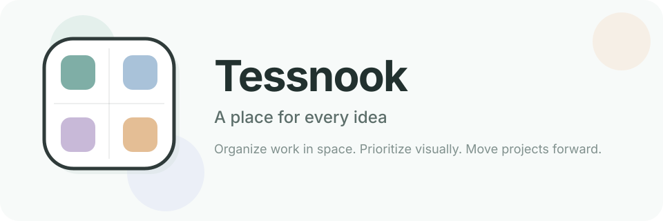

<p align="center"></p>

# Tessnook

*A place for every idea* · 空间化协作看板

一款基于无限网格画布的空间化任务协作 Web 应用。用户在「重要性 × 紧急性」四象限区域中自由摆放、整理和堆叠**事件包**，点击事件包即在右侧打开 Trello 式工作看板；支持多用户共享工作空间、实时协作和事件归档。

> 用空间组织注意力，用事件包组织工作，用看板推进执行。

## 快速开始

```bash
npm install
npm run dev          # http://localhost:5173
```

不配置任何环境变量时，应用以**本地模式**运行：账户和数据保存在浏览器 localStorage 中，多个标签页之间通过 BroadcastChannel 模拟实时通道。在两个标签页分别注册不同账户，就可以体验邀请、在线状态、实时同步和权限控制，不需要任何后端。

### 连接 Supabase（云端模式）

1. 新建 Supabase 项目，执行 `supabase/migrations/20261123000000_init.sql`（`supabase db push`，或整段粘贴到 SQL Editor 运行）。
2. 复制 `.env.example` 为 `.env.local`，填入 `VITE_SUPABASE_URL` 和 `VITE_SUPABASE_ANON_KEY`（Project Settings → API）。
3. `npm run dev`。前端会自动切换为 `SupabaseRepo`。
4. 验证云端模式（测试期间需在 Authentication → Sign In / Providers → Email 关闭 "Confirm email"）：

   ```bash
   SUPABASE_URL=https://xxxx.supabase.co SUPABASE_ANON_KEY=... npm run verify:supabase
   ```

   脚本会以 3 个一次性账户检查认证、RLS 隔离、角色权限、事务 RPC、版本冲突、邀请、Realtime 推送、在线状态和成员移除后的推送撤销，结束时删除测试工作空间。

### 部署到 Cloudflare Pages

构建命令填 `npm run build`，输出目录填 `dist`，并在 Pages 的环境变量中设置上面两个 `VITE_` 变量。

## 测试

| 命令 | 内容 |
|---|---|
| `npm test` | Vitest：布局算法（象限判定、网格整理、排序键）和本地数据层（版本冲突、堆叠约束、权限） |
| `npm run test:e2e` | Playwright：完整用户流程，包括两个账户的实时协作 |
| `PGURL=postgres://… npm run test:db` | 在真实 PostgreSQL 15+ 上执行迁移，并测试 RLS 隔离、角色权限、RPC 事务和版本冲突 |
| `npm run verify:supabase` | 针对真实 Supabase 项目的端到端验证（见上文），`--skip-realtime` 可跳过 WebSocket 检查 |

## 架构

```
src/
  domain/      业务类型与纯函数布局算法（不依赖 React Flow）
  data/        Repo 接口 + LocalRepo（浏览器内“服务端”）+ SupabaseRepo
  store/       zustand：乐观更新、串行写队列、实时合并、冲突回退与快照校准
  canvas/      React Flow 适配层（adapter.ts）与自定义节点：区域 / 事件包 / 卡片堆
  board/       Trello 式看板（dnd-kit）与任务详情
  components/  顶栏、搜索、归档中心、成员与邀请、活动记录、登录
brand/         品牌素材源文件（图标、App 图标、横幅、社交预览图），见 brand/README.md
public/        网站图标（favicon、PWA 图标、apple-touch-icon）与 logo
supabase/
  migrations/  表结构、复合外键、RLS、触发器、事务性 RPC、Realtime 发布
  tests/       auth stub + RLS/RPC 测试脚本
```

**关键设计决定**

- **数据与画布解耦**：数据库只保存世界坐标和业务字段，`canvas/adapter.ts` 负责转换成 React Flow 节点。以后更换画布引擎只需要重写这一层。
- **象限归属与坐标分别保存**：`events.region_id/quadrant` 与 `x/y` 是独立字段。只有拖拽结束时才按卡片中心重新判定一次象限，象限内的微小移动不会改变优先级。
- **区域主体不拦截指针**：在区域内依然可以平移画布、框选和双击创建事件包；只有区域标题栏可以拖动区域，拖动时区域内的事件包和卡片堆一起移动（`move_region` 在同一事务中完成）。
- **乐观并发**：每张业务表都有 `version`，由触发器递增。普通字段更新使用 `update … where version = 预期版本`，多表操作通过 RPC 在事务中检查版本。冲突时提示用户，并以数据库快照校准，避免静默覆盖。
- **同一客户端串行写入**：store 中的写操作排成单一队列，连续编辑不会因为版本号还没返回而与自己冲突。拖拽使用拖动开始时记录的版本号。
- **跨空间引用在数据库层禁止**：所有外键都是 `(id, workspace_id)` 复合外键；`tasks(list_id, event_id)` 同样是复合外键，保证任务只能属于本事件包的列表。
- **断线恢复**：`workspaces.revision` 在每次业务写入时 +1。本地模式检测到修订号跳变时重新同步；Supabase 模式在每次重连（`SUBSCRIBED`）和 `online` 事件时重新拉取快照。
- **权限**：Owner / Editor / Viewer 三种角色由 RLS 和 RPC 内的显式检查共同保证。永久删除事件包仅 Owner 可执行；成员管理只能通过 `security definer` RPC 进行；邀请凭证只保存 SHA-256 哈希，并且只能使用一次。

## V1 里程碑状态

| 里程碑 | 状态 |
|---|---|
| M1 工程、认证、工作空间、成员、RLS | ✅ 已实现。数据库测试覆盖数据隔离、角色权限和成员移除后的访问撤销 |
| M2 画布、四象限区域、事件包、持久化、侧边面板 | ✅ 已实现 |
| M3 网格整理/撤销、多选、堆叠、看板、检查清单、完成/归档/恢复 | ✅ 已实现 |
| M4 实时同步、在线状态、版本冲突、重连校准 | ✅ 已实现。Supabase 云端已验证认证、RLS、权限、RPC、冲突与邀请；Realtime/Presence 尚需在可用 WebSocket 的环境中运行 `npm run verify:supabase` 确认 |
| M5 性能压测、备份恢复演练、正式部署 | ⏳ 待做 |

**已知限制和下一步**

- Supabase 云端模式已在真实项目上验证（`verify:supabase` 14/14，以及前端完整流程）。Realtime 推送、Presence 和成员移除后的推送撤销仍需在支持 WebSocket 的环境中运行 `npm run verify:supabase`（不加 `--skip-realtime`）确认。
- 正式上线前请重新开启 Supabase 的邮箱确认（Authentication → Sign In / Providers → Email → Confirm email），并配置站点 URL 与重定向地址。
- `workspaces.revision` 由行级触发器递增；批量操作较多时可以改为语句级触发器以减少写放大。
- 500 个事件包规模的性能尚未压测（技术风险 17.1）。
- 邀请目前只生成链接，没有发送邮件。如需邮件邀请，可以增加一个调用邮件服务的 Edge Function。

## 许可协议

Tessnook 采用 [PolyForm Noncommercial License 1.0.0](LICENSE) 发布。

- **非商业用途免费**：个人学习、研究、爱好项目，以及慈善、教育、公益、科研和政府机构的非商业使用，都可以免费使用、修改和分发（分发时需附带许可协议和 `Required Notice` 行）。
- **商业用途需要授权**：在商业产品、商业服务或公司内部的营利性工作中使用，需要另行取得商业授权。请通过 [GitHub](https://github.com/dkturingfz) 联系作者。

注意：这是"源码可见"（source-available）协议，而不是 OSI 定义的开源协议。
